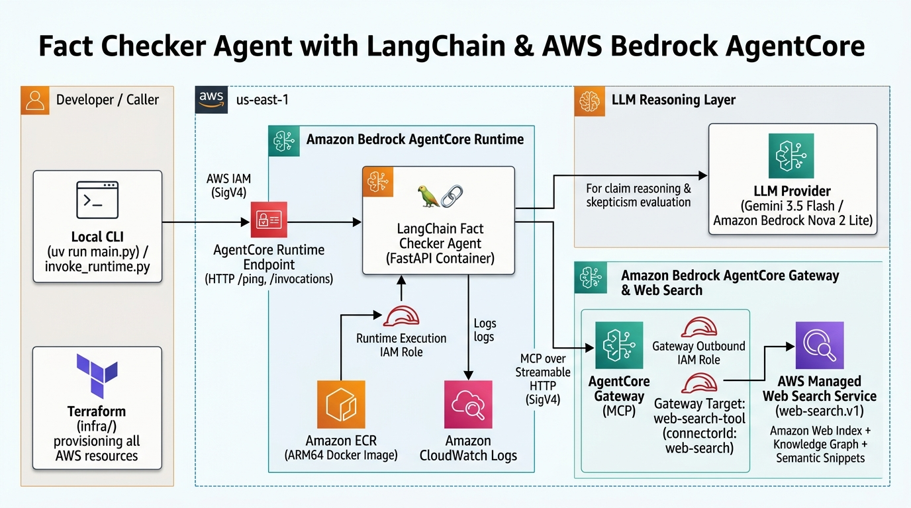
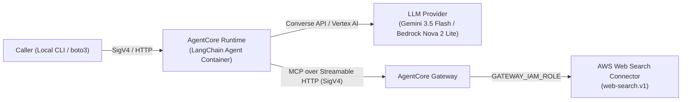

# Fact Checker Agent (LangChain + AWS Bedrock AgentCore)

A skeptical fact-checker AI agent built with **LangChain** (`langchain` + `langchain-aws` + `langchain-mcp-adapters`), deployed on **Amazon Bedrock AgentCore Runtime**, and grounded in live public web data using the managed **Web Search on Amazon Bedrock AgentCore** MCP connector.

This project is the LangChain + AWS Bedrock AgentCore counterpart to `fact-checker-agent-adk`.

---

## Architecture Overview





### How the AWS Services Work Together

1. **Infrastructure Provisioning (`Terraform`)**: Provisions the **Amazon ECR** repository, least-privilege **IAM Roles** (Runtime execution role & Gateway outbound role), the **AgentCore Gateway**, the **Web Search Gateway Target**, and the **AgentCore Runtime & Endpoint** in `us-east-1` (see [`infra/`](./infra) and [ADR 0001](./docs/adr/0001-terraform-for-aws-infrastructure.md)).
2. **Compute & Container Hosting (`Amazon Bedrock AgentCore Runtime` + `Amazon ECR` + `CloudWatch Logs`)**: Pulls the `linux/arm64` FastAPI + LangChain container image from **Amazon ECR**, runs it behind the SigV4-authenticated **AgentCore Runtime Endpoint** (`GET /ping` and `POST /invocations` on port `8080`), and streams execution logs to **Amazon CloudWatch Logs**.
3. **LLM Reasoning (`Gemini 3.5 Flash` / `Amazon Bedrock Nova 2 Lite`)**: The LangChain agent (`create_agent`) evaluates the incoming claim with skepticism (`temperature=0.1`) and determines what search queries to run (see [ADR 0002](./docs/adr/0002-nova-2-lite-foundation-model.md)).
4. **Live Web Grounding (`AgentCore Gateway` + `Web Search Connector`)**: The LangChain agent connects to the **AgentCore Gateway** over MCP (`Streamable HTTP` signed with AWS IAM `SigV4`, see [ADR 0003](./docs/adr/0003-aws-iam-sigv4-authentication.md)), discovers `web-search-tool___WebSearch` via `tools/list`, and invokes it. The Gateway uses its `GATEWAY_IAM_ROLE` (`bedrock-agentcore:InvokeWebSearch`) to query the **AWS Managed Web Search Service (`web-search.v1`)**, returning semantic snippets and knowledge-graph facts from Amazon's live web index.
5. **Domain Glossary**: See [`CONTEXT.md`](./CONTEXT.md).

---

## Prerequisites

1. **[uv](https://docs.astral.sh/uv/)** (used exclusively for all Python environment and dependency management).
2. **AWS CLI v2** (`>= 2.13.22`) configured with credentials for `us-east-1` (Web Search on AgentCore is available in `us-east-1`).
3. **Terraform** (`>= 1.5.0`).
4. **Docker** with `buildx` support (to build `linux/arm64` images for AgentCore Runtime).
5. **Amazon Bedrock Model Access** enabled on your AWS account for `us.amazon.nova-2-lite-v1:0` (or your chosen Bedrock model).

---

## 1. Set Up AWS Resources (Terraform)

Infrastructure provisioning is split into two stages so the ECR repository and AgentCore Gateway exist before AgentCore Runtime pulls the container image.

### Stage 1: Provision ECR, IAM Roles, AgentCore Gateway, and Web Search Target

```bash
terraform -chdir=infra init
terraform -chdir=infra apply -var="deploy_runtime=false"
```

After Stage 1 finishes, copy the `gateway_url` output into your local `.env` file:

```bash
cp .env.example .env
# Set AGENTCORE_GATEWAY_URL to the output of:
terraform -chdir=infra output -raw gateway_url
```

### Stage 2: Build & Push the ARM64 Container Image and Deploy AgentCore Runtime

AgentCore Runtime requires an **ARM64 (`linux/arm64`)** container image exposing `GET /ping` and `POST /invocations` on port `8080`:

```bash
ECR_URL=$(terraform -chdir=infra output -raw ecr_repository_url)

aws ecr get-login-password --region us-east-1 | \
  docker login --username AWS --password-stdin "${ECR_URL%/*}"

docker buildx build --platform linux/arm64 --load -t fact-checker-langchain:v1.0.0 .
docker tag fact-checker-langchain:v1.0.0 "${ECR_URL}:v1.0.0"
docker tag fact-checker-langchain:v1.0.0 "${ECR_URL}:latest"

docker push "${ECR_URL}:v1.0.0"
docker push "${ECR_URL}:latest"
```

Now provision the **AgentCore Runtime** and **AgentCore Runtime Endpoint**:

```bash
terraform -chdir=infra apply -var="deploy_runtime=true"
```

Save the runtime ARN into `.env` if you want to invoke the deployed runtime using [`invoke_runtime.py`](./invoke_runtime.py):

```bash
terraform -chdir=infra output -raw agent_runtime_arn
```

---

## 2. Run the Agent Locally (with `uv`)

Install dependencies using `uv`:

```bash
uv sync
```

### Option A: Local CLI Fact-Check

Run a single fact check from your terminal (this connects to your AWS Bedrock model and invokes the live AgentCore Gateway Web Search MCP tool over IAM SigV4):

```bash
uv run main.py "The Sydney Harbour Bridge was opened in 1955."
```

### Option B: Local FastAPI Server (AgentCore Runtime Contract)

Start the HTTP server locally (binds to `127.0.0.1:8080` by default):

```bash
uv run main.py --serve
```

In another terminal, test the health check and invocation endpoints:

```bash
# Health check
curl http://127.0.0.1:8080/ping

# Fact-check invocation
curl -X POST http://127.0.0.1:8080/invocations \
  -H "Content-Type: application/json" \
  -d '{"claim": "The Sydney Harbour Bridge was opened in 1955."}'
```

### Option C: Invoke the Deployed AgentCore Runtime on AWS

Once Stage 2 (`deploy_runtime=true`) is applied and the runtime endpoint status is `READY`:

```bash
uv run invoke_runtime.py "The Sydney Harbour Bridge was opened in 1955." \
  --runtime-arn "$(terraform -chdir=infra output -raw agent_runtime_arn)"
```

---

## 3. Tear Down AWS Resources

AgentCore Gateways, Web Search tool invocations ($7 per 1,000 queries), and AgentCore Runtime endpoints are billable resources. To cleanly remove all AWS resources (Runtime Endpoint, Runtime, Gateway Target, Gateway, IAM Roles, and ECR Repository):

```bash
terraform -chdir=infra destroy
```
